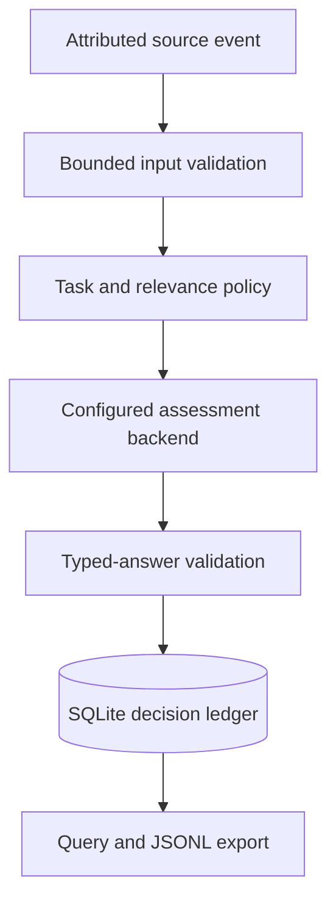

# Content Intelligence Engine

  [](LICENSE)

Turn attributed source content into typed assessments that can be queried, exported and traced back to the original input.

The pipeline accepts bounded source events, applies assessment/relevance policies, validates backend answers and records decisions in a persistent ledger. It is designed for content analysis across news, websites and social/development sources; the package retains its `omnia-news` command names.

## Source contract first

[contracts.py](src/omnia_news/contracts.py) requires source identity, platform, URL, author, text and observation time. It rejects unknown fields and oversized input, requires timezone-aware timestamps and checks source URLs. Supported platform values include `github`, `x`, `reddit`, `youtube`, `website` and `news`.

```json
{
  "id": "documentation-event-1",
  "platform": "website",
  "url": "https://example.com/update",
  "author": "Example publisher",
  "text": "A synthetic release announcement.",
  "observed_at": "2026-10-20T12:00:00+00:00"
}
```

This is a synthetic source event, not an inference result. Context can retain bounded reply/quote/repost relationships; GitHub commit sources have additional repository/SHA identity checks.

## Assessment lifecycle



The [pipeline](src/omnia_news/pipeline.py), [relevance policy](src/omnia_news/relevance_policy.py) and [query interface](src/omnia_news/query.py) are separate from the local inference adapter. Persistent records preserve evidence and policy context rather than retaining only a final label.

## Run the offline checks

```console
python -m venv .venv
python -m pip install -e .
python -m unittest discover -s tests -v
```

Tests use controlled backends and temporary state. The previously recorded clean installation/offline suite passed; it does not establish the quality of a particular checkpoint. New native inference requires the separately configured runtime and model revision. Use the package's CLI help and [.env.example](.env.example) for runtime inputs; model weights and provider secrets are not bundled.

**Technology:** Python · typed contracts · local inference adapter · SQLite · JSONL · unittest

Source license: [Apache-2.0](LICENSE). Existing upstream and third-party notices are retained.
