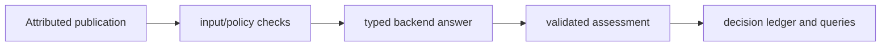

# Content Intelligence Engine

**Attributed content, typed model answers and durable assessment records.**

  [](LICENSE)

[Overview](#overview) · [Quickstart](#quickstart) · [Example](#example) · [Validation](#validation) · [Documentation](#documentation)

## Overview

A Python pipeline that turns source content and typed model answers into durable, evidence-linked assessments.

**Stack:** Python · typed contracts · local inference adapter · SQLite · JSONL · unittest

## An assessment retains its source

| Component | Behavior |
| --- | --- |
| Attribution | Primary publications, replies and quotes retain separate source roles. |
| Validation | Input checks and typed output policies constrain reusable assessments. |
| Persistence | SQLite decision records retain assessment identity, policy and evidence. |

## Processing path



## Quickstart

```console
python -m venv .venv
# Activate .venv, then:
python -m pip install -e .
python -m unittest discover -s tests -v
```

The commands above install prerequisites or run the specified offline checks. Live collection, cloud operations, messaging and trading are separate operational steps when present.

## Example

**Inspect the workflow**

Trace a publication through input checks, backend assessment, typed validation and ledger queries. JSONL supports bounded batch input/output. Controlled backends in the tests demonstrate contract handling without requiring a model download. Existing command names remain `omnia-news`, `omnia-news-batch` and `omnia-news-query`.

## Configuration and storage

Python 3.10+ is declared. [.env.example](.env.example) lists the local checkpoint, inference limits, ledger and content-policy settings. A local inference backend is optional for offline tests; native model execution requires separate installation and checkpoint selection.

## Repository guide

| Location | Responsibility |
| --- | --- |
| [src/omnia_news/cli.py](src/omnia_news/cli.py) | Streaming CLI |
| [src/omnia_news/batch.py](src/omnia_news/batch.py) | Batch processing |
| [src/omnia_news/query.py](src/omnia_news/query.py) | Ledger queries |
| [tests](tests) | Controlled-backend regression checks |

## Validation

All 96 tests passed on Python 3.13.16 using offline fixtures or controlled backends. A live inference checkpoint was not exercised.

## Scope and operational boundaries

Typed-output correctness and record persistence do not measure factual model quality. The last recorded validation passed 96 offline tests on Python 3.13.16; it did not exercise a live checkpoint. Apache-2.0 and upstream notices are preserved.

## Documentation

- [Architecture](docs/ARCHITECTURE.md)
- [API](docs/API.md)
- [Attribution](THIRD_PARTY_NOTICES.md)

## License and attribution

See [LICENSE](LICENSE), [THIRD_PARTY_NOTICES.md](THIRD_PARTY_NOTICES.md).
